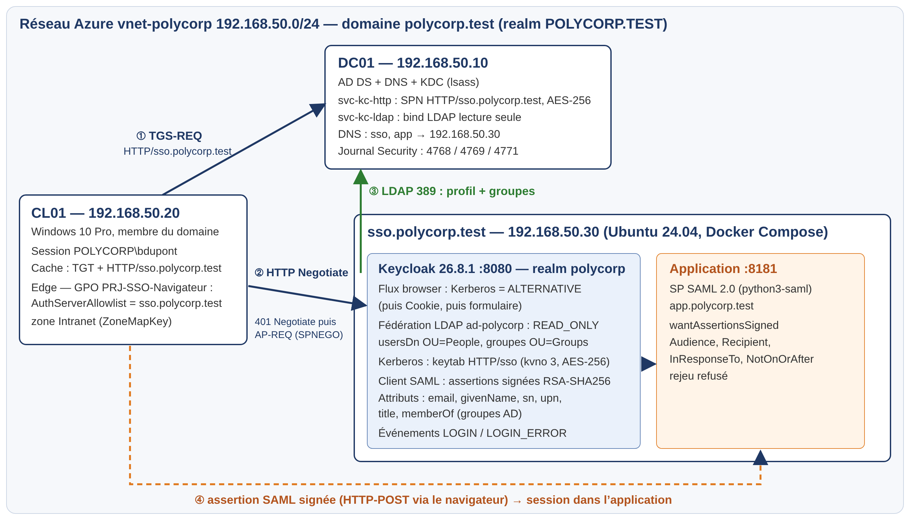

# Projet 2 – Du poste Windows au web sans mot de passe

Mini-projet du cours **Gestion des Accès-Identités** (Dr. Salah Gontara, Polytechnique Sousse, 2026-27).

Un utilisateur ouvre sa session Windows dans le domaine **polycorp.test**, puis ouvre une application web SAML. Il n'a **pas à ressaisir son mot de passe** : son ticket Kerberos est présenté au fournisseur d'identité **Keycloak** (SPNEGO). Keycloak vérifie le ticket, retrouve l'utilisateur dans Active Directory (LDAP) et émet une **assertion SAML signée** pour l'application.

```
 CL01 (Windows 10, membre du domaine)        DC01 (AD DS + DNS + KDC)
 ┌──────────────────────────┐   AS/TGS (88)  ┌──────────────────────────┐
 │ session POLYCORP\bdupont │ ─────────────► │ polycorp.test            │
 │ TGT + ticket HTTP/sso    │                │ SPN HTTP/sso -> svc-kc-  │
 │ Edge (GPO : allowlist)   │                │ http ; LDAP 389          │
 └────────────┬─────────────┘                └────────────▲─────────────┘
   1. GET /rh │  4. POST SAMLResponse                     │ 3. LDAP (svc-kc-ldap,
              ▼                                           │    lecture seule)
 ┌──────────────────────────────────────────────────────────┴──────────────┐
 │ sso.polycorp.test (Ubuntu 24.04, Docker)                                │
 │  • app :8181  SP SAML (python3-saml)  ── AuthnRequest ──►               │
 │  • keycloak :8080 realm polycorp : flux browser = Kerberos (ALTERNATIVE)│
 │      2. 401 WWW-Authenticate: Negotiate  ◄──  Authorization: Negotiate  │
 │      keytab HTTP/sso.polycorp.test (AES-256) ; fédération AD READ_ONLY  │
 └─────────────────────────────────────────────────────────────────────────┘
```



Rapport complet : [docs/Rapport_Projet2_Aziz_Chalbi.pdf](docs/Rapport_Projet2_Aziz_Chalbi.pdf)

## Résultats démontrés

| Démonstration | Trace |
|---|---|
| SSO depuis CL01 sans saisie | `klist` : ticket `HTTP/sso.polycorp.test` AES-256 ; page « accès accordé à bdupont » |
| Accès corrélé sur DC01 | 4769 `Service Name = svc-kc-http`, etype 0x12, status 0x0 |
| Attributs AD dans l'assertion | email, givenName, sn, upn, title, memberOf (Developers, Staff) |
| Dialogue réseau | 401 `WWW-Authenticate: Negotiate` → `Authorization: Negotiate` (AP-REQ) → 200 + jeton mutuel |
| Hors domaine / sans ticket | formulaire Keycloak |
| Compte désactivé | 4768 échec 0x12 ; Keycloak `Clients credentials have been revoked (18)` |
| Horloge IdP +10 min | Keycloak `Clock skew too great (37)` |

## Contenu

| Dossier | Rôle |
|---|---|
| `infra/azure/` | Création du laboratoire sur Azure for Students (VNet 192.168.50.0/24, NSG, 3 VM) |
| `infra/ad/` | PowerShell sur DC01 : forêt, OU/comptes/groupes, comptes de service + SPN + keytab, GPO navigateur |
| `keycloak/` | `krb5.conf`, script `kcadm` qui configure le realm (fédération AD, Kerberos, flux, client SAML) |
| `app/` | Fournisseur de service SAML (repris du TP4, chargement automatique des métadonnées IdP) |
| `docker-compose.yml` | Keycloak 26.8.1 + application |
| `tests/verifier.ps1` | Vérification de bout en bout depuis CL01 |
| `docs/` | Rapport et présentation |

## Mise en place (résumé)

1. `infra/azure/01_create_lab.sh` (variables `MYIP`, `.secrets`), puis DNS du VNet = 192.168.50.10.
2. Sur DC01 : `00a_promote_dc.ps1`, `00b_ous_users_groups.ps1`, `01_service_accounts_spn_keytab.ps1`, `02_gpo_navigateur.ps1`. Joindre CL01 au domaine (OU Workstations).
3. Copier `sso.keytab` sur la VM sso dans `keycloak/` (`chmod 600`), créer `.env` depuis `.env.example`, `docker compose up -d --build`.
4. `docker cp keycloak/configure-keycloak.sh prj-keycloak-1:/tmp/ && docker exec -e ADMIN_PW=... -e LDAP_PW=... prj-keycloak-1 bash /tmp/configure-keycloak.sh`
5. Sur CL01, session de domaine : `tests/verifier.ps1`, puis ouvrir `http://app.polycorp.test:8181/rh` dans Edge.

## Choix de sécurité

- Deux comptes de service distincts : `svc-kc-ldap` (bind LDAP, lecture seule) et `svc-kc-http` (porteur du SPN, aucun autre usage). Les deux : non délégables, mot de passe long aléatoire.
- Keytab en **AES-256 uniquement** (`msDS-SupportedEncryptionTypes = 24`, `permitted_enctypes` côté Java), monté en lecture seule.
- Fédération **READ_ONLY**, `NO_CACHE` : un compte désactivé dans AD est refusé immédiatement par le KDC, et Keycloak ne garde aucun mot de passe (`federationLink` = ad-polycorp).
- Assertions et réponses SAML **signées** (RSA-SHA256), Audience et Recipient contrôlés par le SP, rejeu refusé.
- GPO ordinateur : authentification intégrée autorisée **seulement** pour `sso.polycorp.test` (`AuthServerAllowlist` + zone Intranet).
- Limites du labo (documentées dans le rapport) : HTTP sans TLS, LDAP sans LDAPS, `start-dev`, admin temporaire Keycloak.

Les secrets (`.env`, `*.keytab`, `.secrets`) ne sont jamais versionnés.
